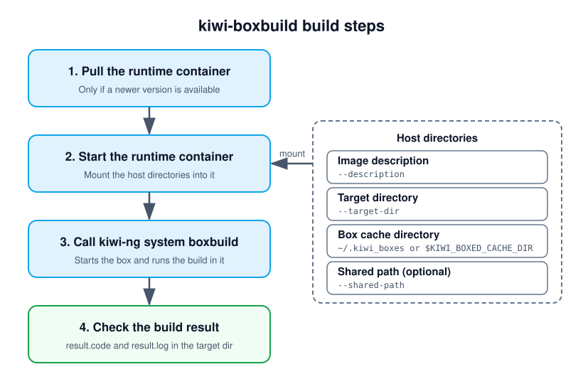

.. _runtime_container_boxbuild:

Building with kiwi-boxbuild
===========================

.. note:: **Abstract**

   This document describes the `kiwi-boxbuild` command. Like the
   {kiwi} `boxbuild` command described in :ref:`self_contained`,
   it builds an image in a self-contained virtual machine, called
   a box, but requires nothing else than `podman` on the build host.

Overview
--------

The `kiwi-boxbuild` command pulls a small runtime container and calls
the `kiwi-ng system boxbuild` command inside of it. The build itself
happens in a box as described in :ref:`self_contained`, which is
started from within the runtime container.

In contrast to calling `kiwi-ng system boxbuild` directly, there is
only the need for `podman` on the build host. The main {kiwi}
requirements as well as the `kiwi-systemdeps-boxbuild` requirements,
like QEMU, are already provided by the runtime container. Neither
{kiwi} nor its dependencies have to be installed on the build host.
This makes `kiwi-boxbuild` useful on host system distributions for
which no {kiwi} packages exist, or to keep the build host free from
the {kiwi} tool chain.

Requirements
------------

The `kiwi-boxbuild` command is provided by the `kiwi-boxbuild`
package. Add the {kiwi} repo from the Open Build Service. For details,
see :ref:`installation-from-obs`. The package only requires `podman`:

.. code:: bash

    $ sudo zypper in kiwi-boxbuild

The box is a KVM based virtual machine started from within the runtime
container. Therefore, the runtime container runs as a privileged
container, and the calling user needs access to the KVM device
:file:`/dev/kvm` on the build host. For building as a non-root user,
a rootless `podman` setup for this user is required.

Building with the kiwi-boxbuild command
---------------------------------------

The `kiwi-boxbuild` command is called in the same way as the
`kiwi-ng system boxbuild` command. The {kiwi} global options `--profile`,
`--type`, `--kiwi-file` and `--debug` are accepted directly by
`kiwi-boxbuild`, as these are passed along to the build in the box.
As with the `boxbuild` command, everything after the `kiwi` subcommand,
or the `--` separator, is passed along to the `build` command running
in the box. The following example builds the same image as the
`boxbuild` example from :ref:`self_contained`:

.. code:: bash

   $ git clone https://github.com/OSInside/kiwi-descriptions.git

   $ kiwi-boxbuild --profile Virtual --box leap kiwi \
         --description kiwi-descriptions/suse/x86_64/suse-leap-15.6 \
         --target-dir /tmp/myimage

The available boxes are listed with:

.. code:: bash

   $ kiwi-boxbuild --list-boxes

   Available boxes, select one with: kiwi-boxbuild --box NAME

     NAME        ARCHITECTURES                    MEMORY  CPUS  CONSOLE
     tumbleweed  x86_64, aarch64, s390x           8096M   4     hvc0
     leap        x86_64                           8096M   4     hvc0
     fedora      x86_64                           8096M   4     hvc0
     ubuntu      x86_64, aarch64                  8096M   4     hvc0
     universal   x86_64, aarch64, s390x, ppc64le  8096M   4     hvc0

The list is read from the `boxbuild --list-boxes` output in the runtime
container. As the runtime container only provides QEMU for the host
architecture, a box is only usable if it is provided for the host
architecture. Boxes which are not provided for it are named below the
list.

When called, `kiwi-boxbuild` performs the following steps:

   The steps performed by `kiwi-boxbuild`.

.. note::

   As with the `boxbuild` command, only the image description, the
   target directory and the optional shared path are shared with
   the box. No other data will be shared with the host.

Supported boxbuild options
--------------------------

`kiwi-boxbuild` provides the options of the `boxbuild` command which
apply to a box started from within the runtime container. For
a description of the options, see :ref:`kiwi_system_boxbuild` or
call `kiwi-boxbuild --help`.

The following options of the `boxbuild` command are not provided by
`kiwi-boxbuild`, as they are not expected to work in the runtime
container:

``--container``
  The runtime container does not provide `podman` to run the box
  as a container. `kiwi-boxbuild` always builds in a virtual machine.

``--sshfs-sharing``, ``--ssh-key``, ``--ssh-port``
  The runtime container does not provide `sshfs`, and the box cannot
  connect to the build host through SSH.

``--9p-sharing``
  The `9p` backend is used by default, if `--virtiofs-sharing` is
  not specified.

``--x86_64``, ``--aarch64``
  The runtime container only provides QEMU for the architecture of
  the build host. `kiwi-boxbuild` always selects the box for the
  host architecture.

Sharing a host path with the box
--------------------------------

With `--shared-path HOST_PATH`, the given host directory is available
at the same location inside of the box as it is present on the host.
`kiwi-boxbuild` also accepts `--shared-path HOST_PATH:BOX_PATH` to make
the host directory available at `BOX_PATH` inside of the box instead:

.. code:: bash

   $ kiwi-boxbuild --box leap --shared-path /data/repos:/repos kiwi \
         --description kiwi-descriptions/suse/x86_64/suse-leap-15.6 \
         --target-dir /tmp/myimage

The location of the shared path inside of the box must not interfere
with the locations `kiwi-boxbuild` uses inside of the runtime container,
which are :file:`/description`, :file:`/result` and
:file:`/root/.kiwi_boxes`.

Using a custom boxes configuration
----------------------------------

The available boxes and their download locations are defined in the
boxes configuration file :file:`kiwi_boxed_plugin.yml`, see
:ref:`kiwi_system_boxbuild`. By default, the boxes configuration
provided with {kiwi} in the runtime container is used. With
`--boxbuild-config FILE`, the given host file is used instead. It is
shared read-only with the runtime container as
:file:`/etc/kiwi_boxed_plugin.yml`, for building as well as for
listing the boxes:

.. code:: bash

   $ kiwi-boxbuild --boxbuild-config my_boxes.yml --list-boxes

   $ kiwi-boxbuild --boxbuild-config my_boxes.yml --box mybox kiwi \
         --description kiwi-descriptions/suse/x86_64/suse-leap-15.6 \
         --target-dir /tmp/myimage

Configuring the runtime container
---------------------------------

By default, `kiwi-boxbuild` uses the following runtime container:

.. code:: bash

   registry.opensuse.org/virtualization/appliances/selfcontained/runtime/images/boxbuild:latest

A different runtime container can be configured in the `boxbuild`
section of the {kiwi} runtime configuration file :file:`kiwi.yml`:

.. code:: yaml

   boxbuild:
     runtime_container: registry.example.com/my/boxbuild:latest

The runtime configuration files are read in the same order as
{kiwi} reads them, and a setting in a later file takes precedence:

1. :file:`/usr/share/kiwi/kiwi.yml` and the :file:`*.yml` files in
   :file:`/usr/share/kiwi/kiwi.yml.d`

2. :file:`/etc/kiwi.yml` and the :file:`*.yml` files in
   :file:`/etc/kiwi.yml.d`

3. :file:`~/.config/kiwi/config.yml`

4. The file given with the `--config` option of `kiwi-boxbuild`

The runtime container is expected to provide `kiwi-ng` as its entry
point, along with the requirements of the `boxbuild` command.
