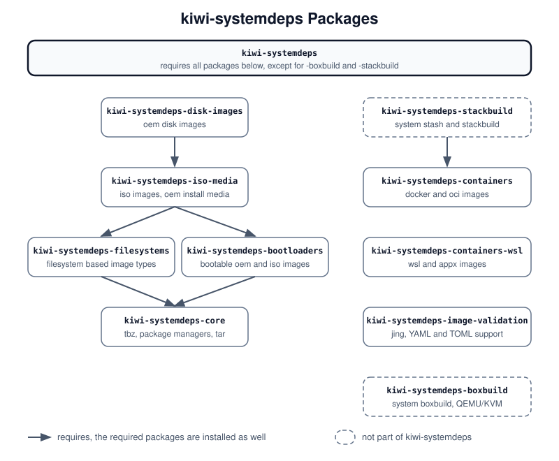

Setting up the Build Host
=========================

.. sidebar:: Abstract

   This page describes the tools the build host needs to build the
   different image types, and the runtime configuration file which
   holds the settings of {kiwi} itself.

.. _systemdeps:

Host Requirements
-----------------

Building an image needs tools on the build host which depend on the
image type, for example tools to create partition tables and
filesystems for a disk image. The `kiwi-systemdeps` packages, built from
the `python-kiwi` package, install these tools. Install the package for
the image type to build; the packages it requires are installed as
well:

age-validation and boxbuild have no requirements.

   The `kiwi-systemdeps` packages and their requirements.

Diagram description:
   The package `kiwi-systemdeps` requires all other `kiwi-systemdeps`
   packages except for `-boxbuild` and `-stackbuild`. `-disk-images`
   requires `-iso-media`, which requires `-filesystems` and
   `-bootloaders`, which both require `-core`. `-stackbuild` requires
   `-containers`. `-containers-wsl`, `-image-validation` and `-boxbuild`
   do not require other `kiwi-systemdeps` packages.

.. list-table::
   :header-rows: 1
   :widths: 40 25 35

   * - Package
     - Builds
     - Installs
   * - `kiwi-systemdeps-core`
     - `tbz` root archives
     - The package managers supported by the distribution and `tar`.
   * - `kiwi-systemdeps-containers`
     - `docker` and `oci` container images
     - The tool chain to build OCI-compliant container images.
   * - `kiwi-systemdeps-containers-wsl`
     - `wsl` and `appx` images
     - The tool chain to build WSL container images. `wsl` is the
       successor of `appx`.
   * - `kiwi-systemdeps-filesystems`
     - `fs-type`, `oem`, `pxe`, `kis` and live `iso` images
     - The tools to create the filesystems supported by {kiwi}, and to
       manage loop devices, partition tables, LVM and LUKS.
   * - `kiwi-systemdeps-bootloaders`
     - Bootable `oem` and `iso` images
     - The bootloader tools of the host architecture.
   * - `kiwi-systemdeps-iso-media`
     - `iso` images and `oem` install media
     - The tools to create ISO filesystems.
   * - `kiwi-systemdeps-disk-images`
     - `oem` disk images
     - The QEMU tools to create virtual disks.
   * - `kiwi-systemdeps-image-validation`
     - Any image type
     - `jing` for detailed reports of image description validation
       errors and, with recommended packages, the `anymarkup` module to
       read image descriptions in YAML or TOML.
   * - `kiwi-systemdeps-boxbuild`
     - Images via `kiwi-ng system boxbuild`
     - The QEMU/KVM tool chain to run the build box, see
       :ref:`self_contained`.
   * - `kiwi-systemdeps-stackbuild`
     - Images via `kiwi-ng system stash` and `kiwi-ng system stackbuild`
     - `podman` and `rsync`, see :ref:`stackbuild`.

To build every image type, install the package `kiwi-systemdeps`. This
pulls in a large number of packages, as the required tools have
dependencies of their own, for example Java for `jing`.

.. tip::

   With the `kiwi-boxbuild` tool, the build host only needs `podman`,
   see :ref:`runtime_container_boxbuild`. `kiwi-boxbuild` also builds
   Linux images on Windows 11, using WSL2.

.. _runtime_config:

The Runtime Configuration File
------------------------------

Settings of {kiwi} itself, which do not belong into an image description
and should persist across calls, are stored in a runtime configuration
file in `YAML <https://yaml.org/>`_ format. {kiwi} reads all of the
following files which exist, in this order, and merges them. Later files
take precedence:

#. :file:`/usr/share/kiwi/kiwi.yml`, the vendor settings
#. :file:`/usr/share/kiwi/kiwi.yml.d/*.yml`, in alphabetical order
#. :file:`/etc/kiwi.yml`, the administrator settings
#. :file:`/etc/kiwi.yml.d/*.yml`, in alphabetical order
#. :file:`~/.config/kiwi/config.yml`, the user settings
#. the file passed with the global `--config` option

The drop-in directories are read whether or not the corresponding main
file exists. The files are merged key by key: a later file only needs
to contain the keys it changes, lists are combined without duplicates.
For example, with the following two files the effective `shasum_size`
is `"256"`, and `compress` stays `true`:

.. code:: yaml

   # /usr/share/kiwi/kiwi.yml
   bundle:
     compress: true
     shasum_size: "512"

.. code:: yaml

   # /etc/kiwi.yml.d/10-local.yml
   bundle:
     shasum_size: "256"

All available settings with a short description are listed in
:file:`/usr/share/kiwi/kiwi.yml.example`, provided by the `python3-kiwi`
package.

.. _runtime_config_sparse_sync:

The sparse data sync
~~~~~~~~~~~~~~~~~~~~

The `sparse` setting of the `sync` section turns runs of null bytes into
holes when {kiwi} syncs data, for example when it installs the image
payload into the image filesystem. It is off by default and applies to
every data sync of {kiwi}.

It saves space if the data contains many null runs. This is the case,
for example, for a distribution compiled for a larger page size, such
as ARM 64K kernels, which leaves zero tails between the segments of
ELF binaries. How much space is saved depends on the filesystem:

* `ext4` and `btrfs` keep the holes.
* `xfs` keeps the holes only with mount options against its
  speculative preallocation. {kiwi} applies them to the mount at
  install time only, they do not become mount options of the system.
* Compressing read-only filesystems, `squashfs` and `erofs`, gain
  nothing, as the compression already removes the null runs.
* In encrypted images the filesystem uses less space, but the image
  file does not get smaller, as {kiwi} fills the device with random
  data before it creates the filesystem. With
  `luks_randomize="false"` the image file gets smaller as well.

Sparse files can fragment the filesystem and the image file. Enable the
setting only if your image gains from it.
