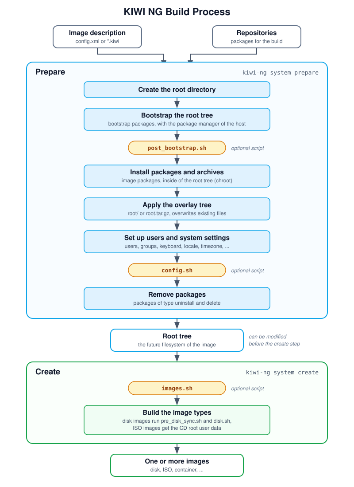

.. _working-with-kiwi-image-building-process:

The Build Process
=================

.. sidebar:: Abstract

   This page describes the two steps in which {kiwi} builds an image:
   the prepare step, which creates the root tree, and the create step,
   which builds the images from it.

   The prepare and the create step, with the optional scripts.

Diagram description:
   The image description and the repositories feed the prepare step.
   The prepare step creates the root directory, bootstraps the root
   tree, runs :file:`post_bootstrap.sh`, installs the packages and
   archives, applies the overlay tree, sets up users and system
   settings, runs :file:`config.sh` and removes packages. The result is
   the root tree. The create step runs :file:`images.sh` and builds the
   image types, which run further scripts for disk images and add the
   CD root user data to ISO images. The result is one or more images.

The command `kiwi-ng system build` runs both steps in one call. They can
also be called separately with `kiwi-ng system prepare` and
`kiwi-ng system create`.

.. _prepare-step:

The Prepare Step
----------------

The prepare step creates the *root tree*, also called the *unpacked
image tree*: a directory which contains the future filesystem of the
image. The packages are installed with the package manager set in the
`packagemanager` element: `apk`, `apt`, `dnf4` (default), `dnf5`,
`microdnf`, `pacman` or `zypper`.

Create the root directory
   {kiwi} stops with an error if the root directory already exists, to
   not delete an existing root tree by accident. The option
   `--allow-existing-root` continues with the existing root tree.

Bootstrap the root tree
   {kiwi} sets up the repositories from the image description and the
   command line. Then it installs the packages of the
   `<packages type="bootstrap">` section with the package manager of the
   build host, outside of the root tree. Usually the packages
   `filesystem` and `glibc-locale` are enough, their dependencies
   provide everything needed for the next step. Afterwards
   :file:`post_bootstrap.sh` runs, if present.

Install packages and archives
   All other packages are installed with the package manager inside of
   the root tree (chroot), followed by the archives from the `archive`
   elements, see :ref:`packages`.

Apply the overlay tree
   The content of the overlay tree, :file:`root/` or
   :file:`root.tar.gz`, is copied into the root tree. Existing files,
   for example files installed by packages or archives, are
   overwritten.

Set up users and system settings
   {kiwi} creates the groups and users, see :ref:`adding-users`, and
   sets up the keyboard, locale, timezone and further system settings
   from the image description.

Run config.sh
   :file:`config.sh` runs in the root tree to complete the system
   configuration, if present. See
   :ref:`working-with-kiwi-user-defined-scripts`.

Remove packages
   The packages of the `<packages type="uninstall">` and
   `<packages type="delete">` sections are removed, see
   :ref:`uninstall-system-packages`.

The root tree also contains the directory :file:`/image` with data
{kiwi} needs in the create step, including a copy of the image
description.

Modifying the Root Tree
~~~~~~~~~~~~~~~~~~~~~~~

The root tree is a plain directory. It can be modified with the
standard tools, or by changing into it with `chroot`, for example to
call the package manager. To do so, run the two steps separately:

.. code:: shell-session

   $ sudo kiwi-ng system prepare --description <description> --root <root>
   $ # modify the root tree in <root>
   $ sudo kiwi-ng system create --root <root> --target-dir <target>

.. warning:: Manual changes are lost with the next prepare step

   Changes made by hand are not part of the image description and are
   lost if the prepare step runs again. Apply changes which should
   persist in the image description instead.

.. _create-step:

The Create Step
---------------

The create step builds one or more images from the root tree. Several
image types can be built from the same root tree, for example a disk
image for a virtual machine and an install ISO, if all of them are
defined in the image description.

Run images.sh
   :file:`images.sh` runs in the root tree first, if present. It is
   used for changes which only apply to the image being built, see
   :ref:`working-with-kiwi-user-defined-scripts`.

Build the image types
   {kiwi} builds the image in the format of the image type. For disk
   images, :file:`pre_disk_sync.sh` and :file:`disk.sh` run during this
   step, if present. For live and install ISO images, the CD root user
   data is added to the ISO media. For the available image types, see
   :ref:`image_types`.
