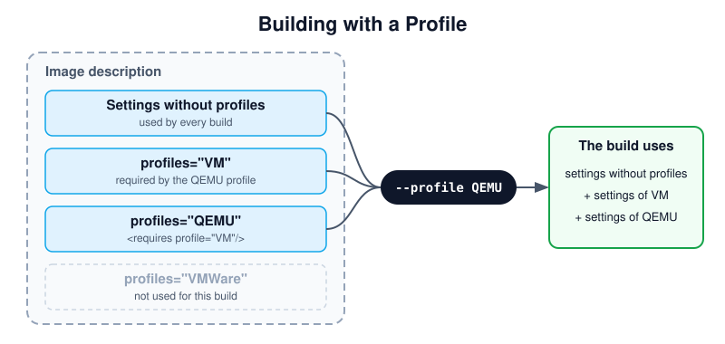

.. _image-profiles:

Profiles
========

.. sidebar:: Abstract

   This page describes profiles, which build variants of an image from
   one image description.

A profile is a named set of settings, used in addition to the settings
which do not belong to a profile. Profiles build variants of an image
from one image description, for example the same disk image for
different virtualization platforms.

   The settings used for a build with the `QEMU` profile.

Diagram description:
   The image description contains settings without a `profiles`
   attribute and settings for the profiles `VM`, `QEMU` and `VMWare`. A
   build with `--profile QEMU` uses the settings without a profile, the
   settings of `QEMU`, and the settings of `VM`, which `QEMU` requires.
   The settings of `VMWare` are not used.

Profiles are declared with `profile` elements in the `profiles` section.
Each profile has a `name`, used to select it, and a `description` for
documentation purposes. Elements which support the `profiles` attribute,
such as `preferences`, `packages`, `repository` or `users`, are only
used for the profiles listed in it, comma-separated. A profile includes
the settings of other profiles with `requires` elements:

.. code:: xml

   <image schemaversion="{schema_version}" name="{exc_image_base_name}">
       <profiles>
           <profile name="VM" description="virtual machine"/>
           <profile name="QEMU" description="virtual machine for QEMU">
               <requires profile="VM"/>
           </profile>
           <profile name="VMWare" description="virtual machine for VMWare">
               <requires profile="VM"/>
           </profile>
       </profiles>
       <preferences>
           <version>15.0</version>
           <packagemanager>zypper</packagemanager>
       </preferences>
       <preferences profiles="QEMU">
           <type image="oem" format="qcow2" filesystem="ext4"/>
       </preferences>
       <preferences profiles="VMWare">
           <type image="oem" format="vmdk" filesystem="ext4"/>
       </preferences>
   </image>

The profile to build is selected on the command line with the global
`--profile` option, which can be given multiple times. A profile with
the attribute `import="true"` is used if no profile is selected. For
details, see :ref:`building-build-with-profiles`.
