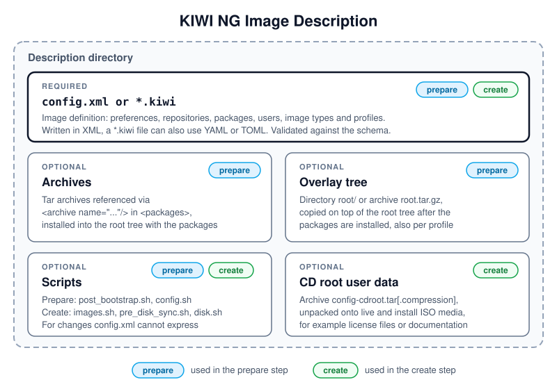

.. _db_overview:

Overview
========

.. sidebar:: Abstract

   This chapter shows the components of an image description, how
   {kiwi} builds an image from it, and explains the concepts and the
   terminology used throughout this documentation for version
   |version|.

.. _description_components:

Components of an Image Description
----------------------------------

   An image description is a directory. Only the image definition is
   required, all other components are optional.

Diagram description:
   The diagram shows the description directory and its components.
   The required :file:`config.xml` or :file:`*.kiwi` file defines the
   image and is used in the prepare and in the create step. The
   optional components are: archives referenced in the `<packages>`
   section, installed with the packages in the prepare step; the
   overlay tree :file:`root/` or :file:`root.tar.gz`, copied into the
   root tree in the prepare step; scripts, run in the prepare and in the
   create step; and the CD root user data
   :file:`config-cdroot.tar[.compression]`, added to live and install
   ISO media in the create step.

For details, see :ref:`image-description` for the image definition and
:ref:`working-with-kiwi-user-defined-scripts` for the scripts.

.. _db_overview_workflow:

Basic Workflow
--------------

{kiwi} builds an image in two steps:

1. **Prepare**: {kiwi} creates a new root tree in a directory from the
   image description. It sets up the repositories, bootstraps the root
   tree and runs :file:`post_bootstrap.sh`, installs the packages and
   archives, copies the overlay tree, sets up users and system
   settings, and finally runs :file:`config.sh`.

   .. code:: bash

      $ sudo kiwi-ng system prepare \
            --description <description-directory> \
            --root <root-directory>

2. **Create**: {kiwi} turns the prepared root tree into one or more
   images of the types defined in the image description. It runs
   :file:`images.sh` first and the type-specific scripts, such as
   :file:`pre_disk_sync.sh` and :file:`disk.sh` for disk images, while
   it builds the image.

   .. code:: bash

      $ sudo kiwi-ng system create \
            --root <root-directory> \
            --target-dir <target-directory>

The command :ref:`kiwi-ng system build <kiwi_system_build>` runs both
steps in one call. The build is fully automated and does not require
any user interaction. For a detailed description of the steps, see
:ref:`working-with-kiwi-image-building-process`.

Concepts
--------

A system image, usually called an *image*, is a *complete installation*
of a Linux system in a file. The image represents an operating system
and, optionally, contains its final configuration.

A Linux system is usually installed by booting an installer from an
installation medium or from the network. The installer asks for the
software to install, the timezone, the users and other settings, and
installs the packages from the available repositories onto the target
system. {kiwi} takes this information from the image description
instead and installs the system ahead of time into the image, without
user interaction. The image is then deployed to the target system or
service, which can happen many times from the same image.

The behavior of the image upon deployment depends on the image type and
its configuration, since {kiwi} allows to fully customize the initial
startup of the image. Among others, an image can:

* run in an existing virtual environment without any configuration
  at startup.
* configure itself automatically in a known target environment.
* prompt the user for an interactive system configuration.

.. note:: Previous Knowledge

   This documentation assumes that you are familiar with the general
   concepts of Linux, including the boot process and distribution
   concepts such as package management.

Terminology
-----------

Appliance
   A ready-to-use image of an operating system, including a
   pre-configured application for a specific use case. The appliance
   is provided as an image file and needs to be deployed to or
   activated in the target system or service.

Image
   The result of a {kiwi} build process.

Image Description
   A specification to define an appliance. The image description is a
   directory with at least one XML file, :file:`config.xml` or
   :file:`*.kiwi`, and optionally further components such as scripts
   and the overlay tree, see :ref:`description_components`.

Image Type
   The format of an image, for example a disk image, a live ISO image
   or a container image. One image description can define several
   image types, see :ref:`image_types`.

Overlay Files
   A directory structure with files and subdirectories stored as part
   of the image description, either as a directory named :file:`root`
   or as an archive named :file:`root.tar.gz`. Additional overlay
   directories named like a profile are taken into account if the
   profile is selected. The content is copied on top of the root tree
   of the appliance, including permissions and attributes.

Profile
   A named part of the image description which is only used if the
   profile is selected. Profiles allow to build variants of an image
   from one image description, see :ref:`image-profiles`.

Root Tree
   The directory which the prepare step creates and which contains
   the future filesystem of the image. It is also called the
   *unpacked image tree*. The create step builds the images from it.

{kiwi}
   An OS appliance builder.

Virtualization Technology
   Software-simulated computer hardware. A virtual machine acts like
   a real computer but is separated from the physical hardware.
   Within this documentation, the QEMU virtualization system is
   used. Another popular alternative is VirtualBox.
